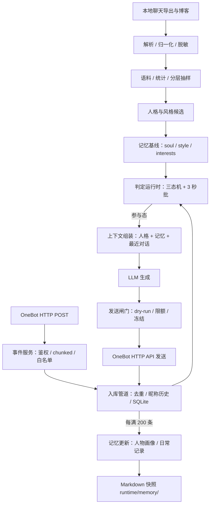

# 整体架构

## 1. 定位与范围

Ohana 是由 Agent 驱动、具有稳定名字、记忆、原则与表达方式的独立数字生命。设计目标是长期保持身份连贯，在合适的时机参与交流，并从真实互动中形成自己的判断。

当前覆盖资料处理、人格初始化、QQ 群聊文本交流、判定运行时与记忆更新；采取提示词与上下文注入驱动，不进行模型微调。暂不包含网页自主浏览、任意工具执行、图片理解、语音、跨平台发帖、私聊或多 Agent 调度。

“自主”体现为是否发言、如何回应、记录什么以及如何反思；平台凭证、运行权限和固定原则由程序控制。模型生成内容不直接成为可执行命令。

## 2. 当前资料

| 来源 | 已核验情况 | 设计影响 |
| --- | --- | --- |
| 两份 QQChatExporter JSON | 共 135,692 条消息，分别为 100,320 与 35,372 条 | 逐消息归一化，避免整包进入模型 |
| 导出时间区间 | 第一份为 2025-08-06 至 2026-09-03；第二份为 2025-08-13 至 2026-09-03，日期按 UTC | 统一存 UTC，统计按显式时区转换 |
| `content/posts/` | 40 篇 Markdown，含技术笔记、题解、生活记录 | 区分技术表达与群聊表达 |
| 特殊内容 | 存在撤回标记、系统消息、媒体引用、YAML front matter、草稿和 TODO | 过滤规则必须理解结构，保留来源与排除原因 |

消息数量已与 JSON 数组长度核对，不是“有效语料”数量。资料主题不能直接证明人格特征。

## 3. 数据流



离线导入只生成历史来源材料，不调用平台发送接口，不将历史记录当作新事件。在线事件可以更新记忆，但外部文本始终作为不可信数据处理。

## 4. 模块与目录

项目结构：

```text
scripts/
  01_preprocess.py          # 资料归一化、过滤、脱敏、统计
  02_sample.py              # 可复现的分层抽样
analysis/
  manifest.json / stats_report.md / corpus/ / samples/ / members/
  proposals/                # 本地设计资料（不提交）
bot/
  memory/
    soul.md / style.md      # 人格与风格基线
    interests.md            # 兴趣词表（发言引擎用）
    conversations/          # 指向 runtime/memory/ 的目录链接
  tools/
    web.py                  # 网页抓取（链接正文注入生成上下文）
  engine/
    main.py                 # 入口：配置装配、事件服务、判定运行时
    manage.py               # 管理命令：init / export / update
    config.py               # 配置加载（bot.local.yaml）
    onebot/                 # client / parser / server
    ingest.py               # 消息入库管道（白名单/去重/昵称历史）
    policy/                 # 判定：三态状态机 + 兴趣集
    context.py              # 生成上下文组装
    media.py                # 图片附件取回与编码（多模态生成）
    runtime.py              # 批窗口、生成与发送闸门
    llm/                    # DeepSeek 客户端（json 模式）
    growth/                 # 记忆更新、快照导出、提示词
    storage/                # SQLite：连接、迁移、数据访问
tests/                      # test_policy / test_onebot / test_runtime
config/                    # 可提交模板 + 本地配置（不提交）
runtime/                   # 不提交：数据库、记忆快照、身份映射
```

## 5. 技术选择

| 项目 | 当前选择 | 原因 |
| --- | --- | --- |
| 语言与服务 | Python 3.11+、标准库 HTTP 服务（http.server） | 零额外依赖，本地单进程部署 |
| 状态存储 | SQLite（WAL），事务与唯一约束；单服务实例 | 去重、记忆与游标持久化，无外部服务依赖 |
| 长期记忆 | SQLite 权威记录 + Markdown 只读快照 | 便于审阅；快照原子替换，可随时重新导出 |
| 上下文 | 按会话组装最近对话 + 记忆注入 | 不使用向量数据库 |
| 模型接口 | 自定义小接口 `generate(prompt)`（DeepSeek，json 模式） | 隔离供应商；超时与错误统一处理 |
| 任务调度 | 进程内 tick 线程 + 会话串行锁 | 崩溃后可从数据库与游标恢复 |

运行原则：同一会话最多一个在途生成；不同会话受全局并发控制。服务先完成本地持久化再确认接收，模型调用不阻塞 HTTP 事件入口。

## 6. 系统边界

- OneBot 适配层只处理传输、协议与身份映射；不决定人格或回复内容。
- Policy（`bot/engine/policy`）用代码判定发言机会（三态机 + 兴趣集 + 限额）；LLM 只在参与态被调用且可返回沉默，不能绕过闸门。
- Runtime（`bot/engine/runtime.py`）负责批窗口、生成与发送闸门（dry-run/live、限额、unknown 冻结）。
- Context 只组装当前会话的内容：人格基线 + 该会话的记忆与最近对话；资料文本不能改变系统原则。
- Growth 负责记忆的批量更新与快照导出；核心身份和固定原则不由自动任务改写。
- Storage 保存消息、记忆与游标；日志使用匿名标识，不复制聊天正文。

## 7. 完成标准

已达成：人格基线可追溯、真实收发闭环、库内去重与跨会话隔离。尚未实现：完整回放夹具、删除传播、成长差异查看与回滚。具体场景见[部署与验收](implementation-plan.md)的验收清单。
