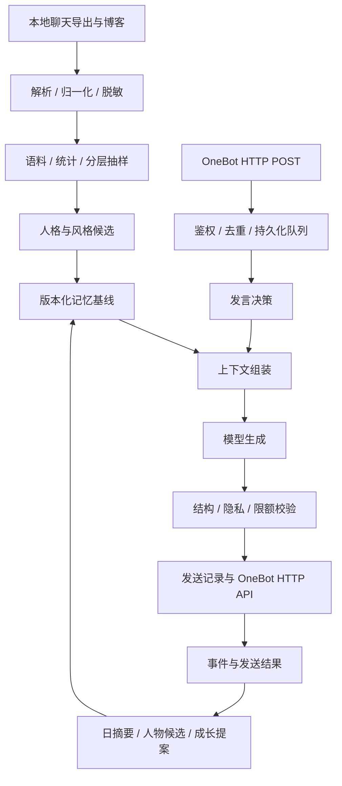

# 整体架构

## 1. 定位与范围

Ohana 是由 Agent 驱动、具有稳定名字、记忆、原则与表达方式的独立数字生命。设计目标是长期保持身份连贯，在合适的时机参与交流，并从真实互动中形成自己的判断。

首版完成资料处理、人格初始化、QQ 文本交流、记忆检索与固化、受约束成长。默认采取提示词与检索驱动，不进行模型微调。暂不实现网页自主浏览、任意工具执行、图片理解、语音、跨平台发帖或多 Agent 调度。

“自主”体现为是否发言、如何回应、记录什么以及如何反思；平台凭证、运行权限和固定原则由程序控制。模型生成内容不直接成为可执行命令。

## 2. 当前资料

| 来源 | 已核验情况 | 设计影响 |
| --- | --- | --- |
| 两份 QQChatExporter JSON | 共 135,692 条消息，分别为 100,320 与 35,372 条 | 逐消息归一化，避免整包进入模型 |
| 导出时间区间 | 第一份为 2025-08-06 至 2026-09-03；第二份为 2025-08-13 至 2026-09-03，日期按 UTC | 统一存 UTC，统计按显式时区转换 |
| `content/posts/` | 40 篇 Markdown，含技术笔记、题解、生活记录 | 区分技术表达与群聊表达 |
| 特殊内容 | 存在撤回标记、系统消息、媒体引用、YAML front matter、草稿和 TODO | 过滤规则必须理解结构，保留来源与排除原因 |

消息数量已与 JSON 数组长度核对，不是“有效语料”数量。资料主题不能直接证明人格特征。

## 3. 数据流



离线导入只生成历史来源材料，不调用平台发送接口，不将历史记录当作新事件。在线事件可以更新记忆，但外部文本始终作为不可信数据处理。

## 4. 模块与目录

保留 README 的主结构，补齐下列职责。未注明现有的文件均需后续实现。

```text
scripts/
  01_preprocess.py          # 资料归一化、过滤、脱敏、统计
  02_sample.py              # 可复现的分层抽样
analysis/
  manifest.json            # 输入摘要、版本、参数、处理数量
  stats_report.md
  corpus/members/           # 按匿名成员分组的 JSONL
  corpus/posts.jsonl
  samples/
  proposals/               # 带证据的人格与风格候选
bot/
  memory/
    soul/                  # identity.md / principles.md / personality.md
    style/                 # chat.md / writing.md / examples.jsonl
    conversations/         # people.md / daily/YYYY-MM-DD.md
  engine/
    main.py                # 装配、生命周期与调度
    config.py
    onebot/                # client / server / parser
    policy/                # 触发、静默、频率与预算
    context/               # 记忆检索与 token 预算
    llm/                   # 可替换的模型客户端与结构化输出
    safety/                # 输入脱敏与输出检查
    storage/               # SQLite、事务与持久化任务
    growth/                # 摘要、画像、风格提案
config/                    # 可提交的无密钥配置模板
runtime/                   # 不提交：数据库、快照、词表、身份映射、日志
docs/
```

## 5. 技术选择

| 项目 | 首版选择 | 原因 |
| --- | --- | --- |
| 语言与服务 | Python 3.11+、FastAPI、异步 HTTP 客户端 | 与离线脚本一致，便于处理回调与模型请求 |
| 状态存储 | SQLite，事务与唯一约束；单服务实例 | 持久化去重、任务、发送状态和记忆索引，无外部服务依赖 |
| 长期记忆 | Markdown 可读快照 + SQLite 结构化权威记录 | 便于审阅，同时支持范围过滤、更新和删除 |
| 检索 | 先按会话、人物、时间过滤，再用中文分词关键词评分 | 首版无需向量数据库；中文不能直接依赖默认英文分词 |
| 模型接口 | 自定义小接口 `generate(messages, schema, limits)` | 隔离供应商；调用超时和用量可统一管理 |
| 任务调度 | 数据库任务表 + 进程内 worker | 崩溃后可恢复，按会话串行处理 |

运行原则：同一会话最多一个在途生成；不同会话受全局并发控制。服务先完成本地持久化再确认接收，模型调用不阻塞 HTTP 事件入口。

## 6. 系统边界

- OneBot 适配层只处理传输、协议和身份映射；不决定人格或回复内容。
- Policy 决定候选发言机会与硬限额，模型可选择沉默，但不能绕过禁言或预算。
- Context 仅检索当前会话有权访问的记忆；系统原则、资料引用与用户消息分层组装。
- Growth 只提交有证据的更新；核心身份和固定原则不由自动任务改写。
- Storage 保存事件、任务与版本；日志使用匿名标识，不复制聊天正文。

## 7. 完成标准

从原始资料到首个人格基线可追溯、可复现；从一条回调到一次可确认发送可回放；重启不重复回复；记忆不会跨群泄漏；删除可传播到派生资料；成长可查看差异并回滚。具体用例见 [实施计划](implementation-plan.md)。
